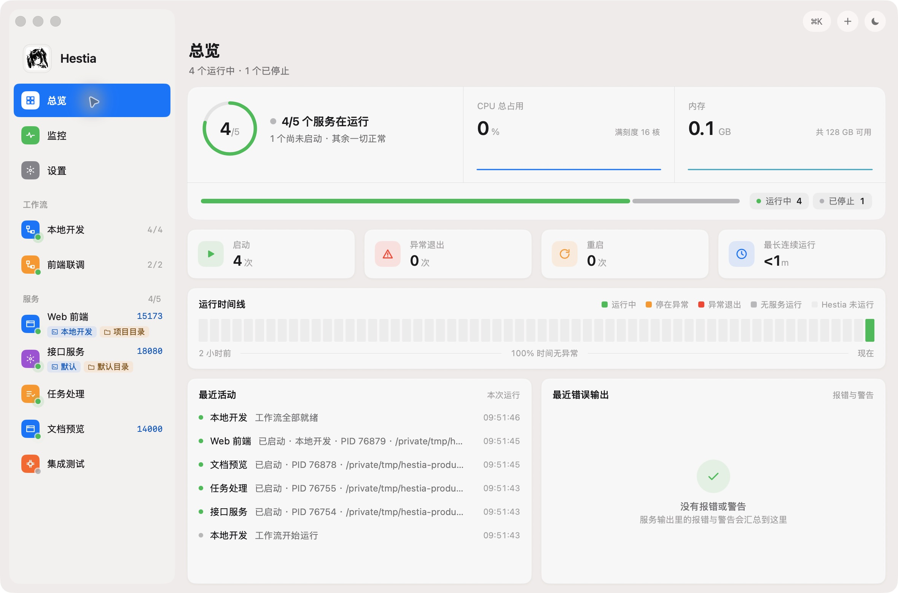
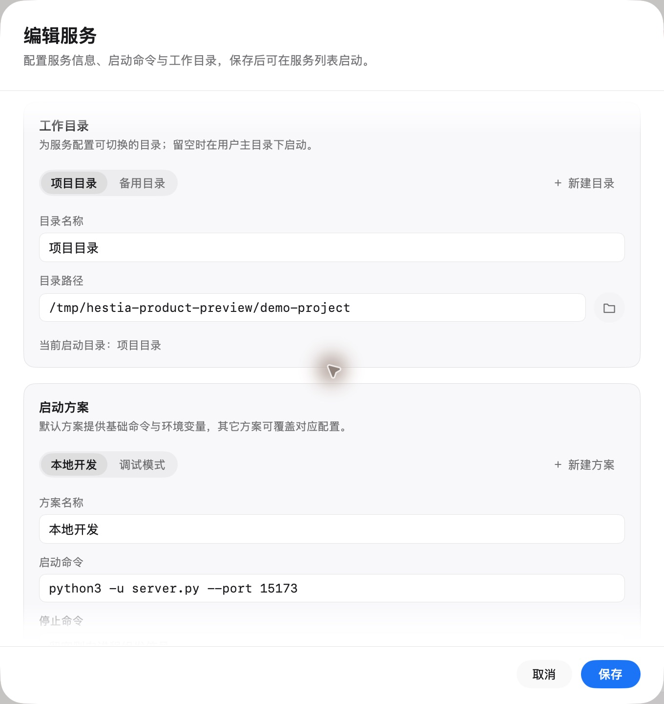
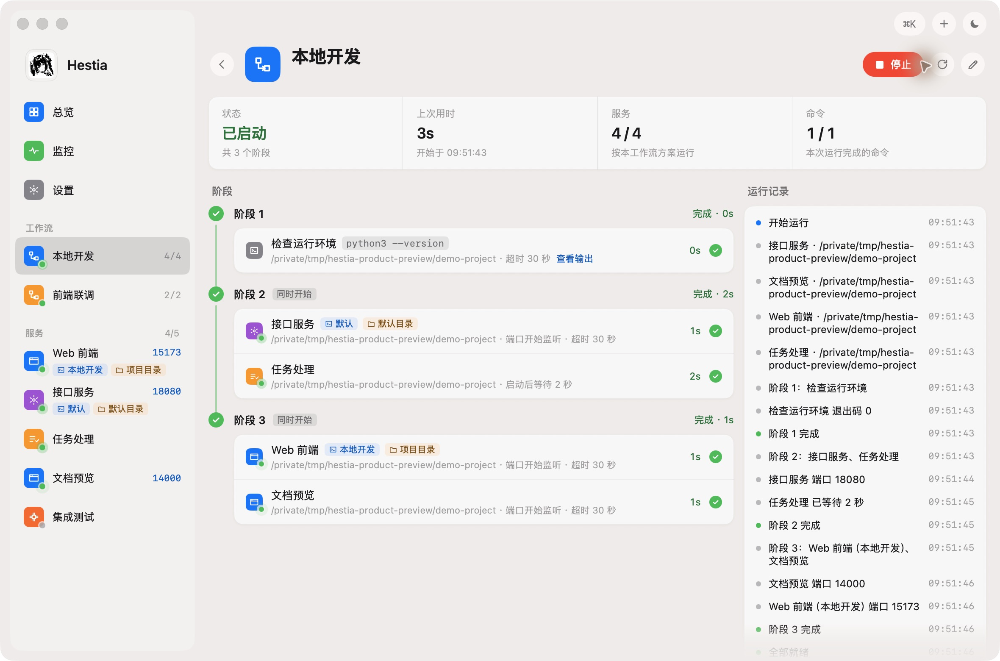
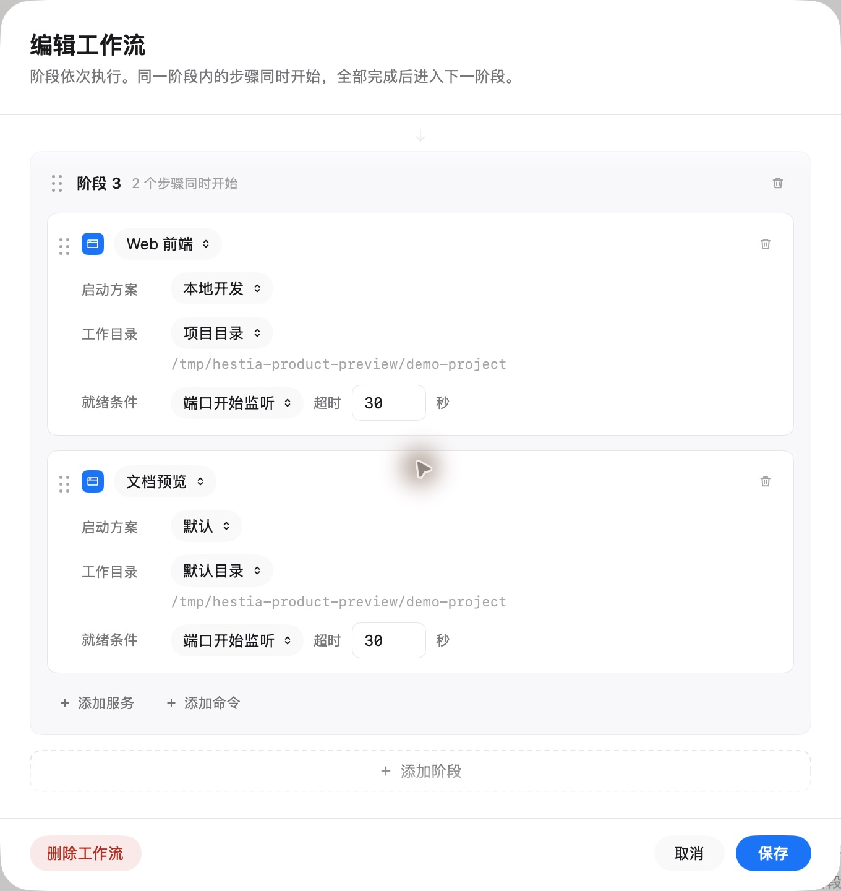
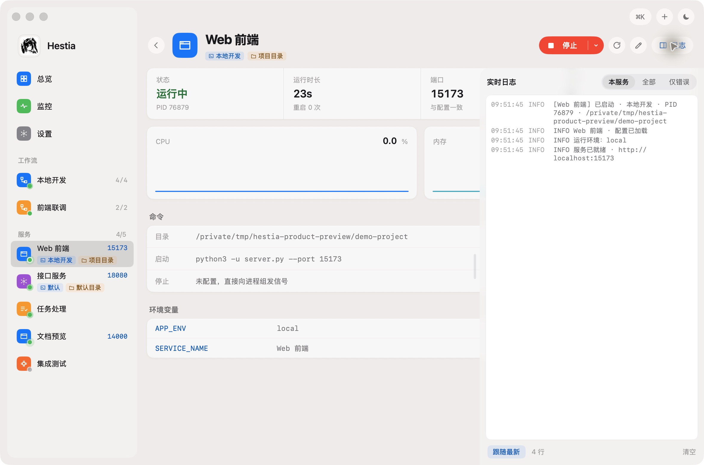
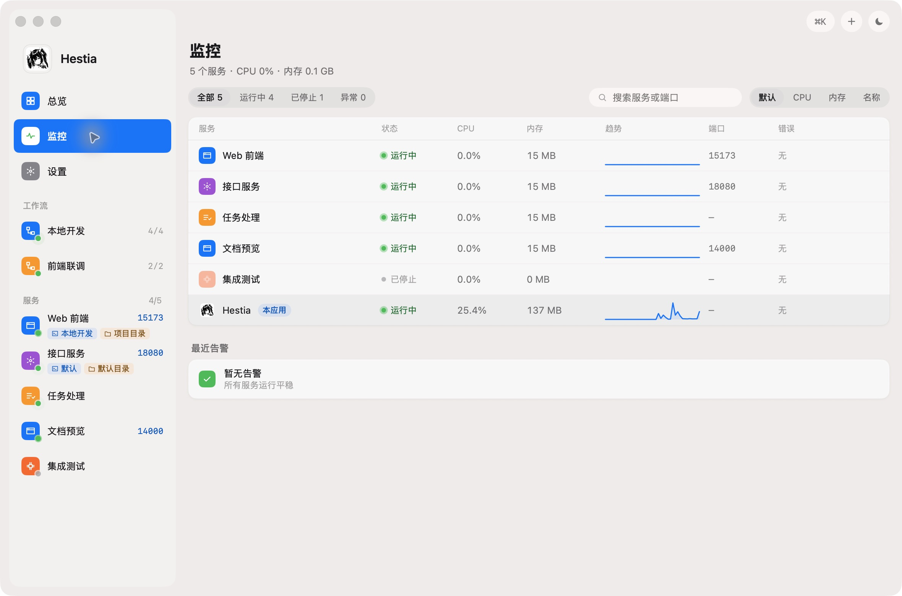
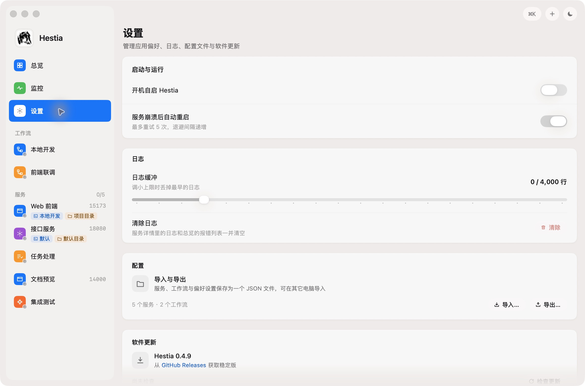

<div align="center">
  
  <h1>Hestia</h1>
  <p><strong>把本地开发环境，汇集到一个窗口。</strong></p>
  <p>面向 macOS 的开发服务管理器<br>管理启动命令、编排工作流、查看日志与资源占用。</p>
  <p>
    <a href="https://github.com/UreMySunshine/hestia/releases">下载应用</a> ·
    <a href="#快速开始">快速开始</a> ·
    <a href="#核心功能">核心功能</a> ·
    <a href="#从源码构建">从源码构建</a>
  </p>
  <p>macOS 26 及以上 · Apple Silicon · SwiftUI + Rust</p>
</div>



一个开发项目，往往需要同时运行前端、接口服务、数据库和后台任务。Hestia 将它们各自的启动命令保存为服务，再用工作流组织启动顺序。开始工作时启动所需环境，开发过程中查看状态与日志，结束时集中停止服务。

| 开发中的需求 | Hestia 提供的能力 |
| --- | --- |
| 每次启动都要重复输入命令 | 保存服务配置，单独启停或批量启动 |
| 服务有依赖，必须按顺序启动 | 分阶段工作流，等待端口监听或指定时长后继续 |
| 同一项目有多种环境、多个开发目录 | 启动方案与工作目录分别选择，复用基础配置 |
| 服务报错或资源占用异常 | 总览、实时日志、进程树资源监控 |
| 关闭窗口后仍需保持服务运行 | 菜单栏常驻，直接管理服务与工作流 |

> 本文截图使用当前版本的独立示例配置。服务名称、命令、端口和运行数据用于展示界面与操作方式。

## 安装

**系统要求：搭载 Apple Silicon 芯片的 Mac，macOS 26 或更高版本。**

1. 从 [GitHub Releases](https://github.com/UreMySunshine/hestia/releases) 下载磁盘映像（DMG）。
2. 打开安装包，将 Hestia 拖入「应用程序」。
3. 启动 Hestia，添加服务并保存启动命令。

应用未做公证签名。首次打开若被 macOS 安全机制拦截，可在「系统设置 → 隐私与安全性」中选择「仍要打开」。后续版本可在 Hestia 的「设置 → 软件更新」中下载安装。

## 快速开始

### 1. 添加第一项服务

点击右上角的 **＋ → 新建服务**，填写名称、工作目录和启动命令。例如，一个已有的前端项目可以使用：

| 配置项 | 示例 |
| --- | --- |
| 服务名称 | Web 前端 |
| 服务类型 | Web / 前端 |
| 工作目录 | `~/dev/my-project` |
| 启动命令 | `pnpm dev --port 5173` |
| 监听端口 | `5173`，可选 |

保存后点击「启动」。命令使用登录 shell 执行，项目所需的工具和依赖应已安装。工作目录支持 `~`；留空时在用户主目录下启动。

### 2. 查看运行结果

在服务详情中确认状态、运行时长与实际监听端口，点击「日志」查看输出。侧栏中运行服务的端口可直接打开对应的 `localhost` 地址。

### 3. 组合成工作流

添加其它服务后，点击 **＋ → 新建工作流**。将相互独立的步骤放在同一阶段，将有依赖的步骤放在后续阶段。例如：

| 阶段 | 步骤 | 进入下一阶段的条件 |
| --- | --- | --- |
| 1 · 准备环境 | 执行一次性检查命令 | 命令成功退出 |
| 2 · 启动基础服务 | 接口服务与后台任务同时启动 | 接口开始监听端口，后台任务达到指定等待时长 |
| 3 · 启动前端 | 前端与文档预览同时启动 | 两项服务均满足各自的就绪条件 |

保存后点击「启动」，工作流页面会显示阶段进度、步骤结果与运行记录。

## 核心功能

### 服务管理：命令、环境与目录统一保存

每项服务包含名称、类型图标、启动命令、可选停止命令、环境变量和工作目录。默认目录与默认方案也可在服务编辑界面修改名称，保存后会同步显示在相关标签和选择菜单中。可以单独启动、停止和重启，也可以从菜单栏或命令面板操作。

**启动方案**适用于同一服务的不同运行方式，例如本地开发与调试模式。默认方案保存基础配置，其它方案只需填写差异：

- 启动命令与停止命令留空时，沿用默认方案。
- 同名环境变量覆盖默认值，新变量追加到运行配置。
- 服务详情展示合并后的实际命令与环境变量，并标明配置来源。

**工作目录**适用于在不同项目副本或 Git 工作树（worktree）间复用配置。一个服务可以保存多个命名目录，分别选择启动方案和目录。目录菜单可识别 Git 分支，普通目录则显示路径。

服务停止时，选择方案或目录会保存为下一次启动的配置；服务运行时切换会先停止当前进程，再按新的选择启动。每项服务同时管理一个运行实例，重启与自动重启沿用该实例启动时的配置。

<details>
<summary>查看服务配置界面</summary>



</details>

### 工作流：按依赖组织整套开发环境

工作流由多个阶段组成，**阶段顺序执行，同一阶段内的步骤并行执行**。当前阶段全部完成后，才会开始下一阶段。



| 步骤类型 | 用途 | 完成条件 |
| --- | --- | --- |
| 服务步骤 | 启动需要持续运行的服务 | 进程树开始监听端口，或启动后等待指定秒数 |
| 命令步骤 | 运行检查、安装依赖等一次性任务 | 在超时前以退出码 `0` 结束 |

服务步骤可指定启动方案和工作目录，也可跟随服务的当前选择。命令步骤可使用固定目录，或跟随指定服务在本次工作流中的目录。阶段和步骤支持拖拽排序，步骤也可通过右键菜单移动到其它阶段。

工作流会在开始前确定各步骤的实际配置，执行期间修改配置不影响本次运行。已按相同方案和目录运行的服务会直接判断就绪，无需重复启动。

<details>
<summary>查看工作流配置界面</summary>



</details>

### 总览：掌握整个环境的运行状态

总览集中展示运行、停止和异常的服务数量，以及处理器（CPU）和内存总占用。启动次数、异常退出次数、重启次数与最长连续运行时长，帮助判断本次运行情况。

运行时间线覆盖最近两小时，按时段呈现运行与异常状态。下方分别汇总最近活动及服务输出中的报错、警告，点击记录即可进入对应服务或工作流。

### 实时日志：从状态进入具体输出



在服务详情中点击「日志」，或按 `⌘L` 打开右侧日志抽屉。支持查看本服务、全部日志或仅错误，并可跟随最新输出。

日志读取标准输出与标准错误输出，按内容识别级别。默认保留最近 **4,000 行**，可在设置中调整为 **1,000–20,000 行**；清除日志会同时清空总览中的报错列表。

### 资源监控：查看服务的实际进程占用



监控面板每 1.4 秒采样一次，按进程父子关系汇总服务及其子进程的 CPU 和常驻内存，展示资源趋势、实际端口与错误信息。支持按状态筛选、按服务名或端口搜索，以及按 CPU、内存或名称排序。

Hestia 自身的占用单独列在表格末尾。服务的 CPU 使用率以单核为 `100%`，多进程服务可能超过 `100%`；总览的 CPU 图表以本机所有核心的总容量为满刻度。

### 菜单栏与命令面板：随时操作运行环境

关闭主窗口后，Hestia 继续常驻菜单栏并管理服务。菜单栏面板可以启停服务和工作流，也可执行全部启动、全部停止；点击条目可返回主窗口查看详情。火箭图标会随服务运行状态切换动画。

按 `⌘K` 打开命令面板，可搜索服务、切换启动方案、启停工作流或跳转页面。主窗口支持浅色与深色外观，侧栏的服务和工作流支持拖拽排序。

### 设置与配置迁移



- **启动偏好**：设置登录后自动启动 Hestia，以及服务异常退出后的自动重启。
- **配置迁移**：将服务、工作流与偏好设置导出为一个 JSON 配置文件，在另一台电脑导入。项目目录、依赖和相关工具需另行准备。
- **合并导入**：相同标识的服务或工作流以文件为准，其余配置保留，偏好设置不变。
- **替换导入**：以文件内容为准，停止并删除文件中不存在的服务，同时导入偏好设置；开机自启保留本机设置。
- **软件更新**：自动检查与自动安装默认开启，每 24 小时检查一次。发现新版本后后台下载，待没有服务运行、没有工作流执行且应用不在前台时安装并重启。

配置保存在 `~/Library/Application Support/com.kira.hestia/config.json`。首次运行没有预置服务。

## 运行规则

### 服务停止与异常恢复

停止服务时，Hestia 优先执行已配置的停止命令；服务仍未退出时，向进程组发送终止信号，必要时强制结束，以回收服务的子进程。

启用自动重启需要同时打开全局设置和服务自身的重启选项。异常退出后最多重试 5 次，等待间隔依次为 1、2、4、8、16 秒。

退出 Hestia 会停止被管理的进程。应用被强制结束时，可能无法立即清理进程；下次启动会核对上次记录的进程信息，回收确认匹配的残留进程。

### 工作流失败与共享服务

| 情况 | 处理方式 |
| --- | --- |
| 步骤失败或等待就绪超时 | 后续阶段不再执行，已启动的服务保持运行；页面展示失败原因 |
| 停止工作流 | 取消未完成步骤，按阶段倒序停止与本次工作流方案及目录匹配的服务 |
| 其它已启动且未停止的工作流仍在使用服务 | 保留该服务，并在运行记录中说明 |
| 重新运行工作流 | 先取消旧运行并停止其使用的服务，再执行新阶段；仍被其它工作流使用的服务保留 |
| 服务由其它位置启动、停止或切换 | 工作流页面按服务的实际运行状态与方案、目录更新步骤状态 |

「已就绪」表示服务已符合工作流配置，但该工作流尚未启动；「已启动」表示工作流已运行且服务符合配置。部分服务满足条件时，分别显示「部分就绪」或「部分运行」。

命令步骤跟随的服务若在同一工作流中使用多个不同目录，需要为该命令指定固定目录。

## 快捷键

| 操作 | 快捷键 |
| --- | --- |
| 打开命令面板 | `⌘K` |
| 开关日志抽屉 | `⌘L` |
| 全部启动 / 全部停止 | `⇧⌘R` / `⇧⌘.` |
| 切换深浅色 | `⇧⌘T` |
| 总览 / 监控 / 设置 | `⌘1` / `⌘2` / `⌘3` |

## 从源码构建

需要 Rust，以及提供 macOS 26 SDK（软件开发工具包）的 Xcode 或 Command Line Tools。构建脚本直接调用 `cargo` 与 `swiftc`，无需 Xcode 工程。

```bash
bash mac/build.sh --dev
open "mac/build/Hestia Dev.app"
```

开发版使用独立应用标识和配置目录，可与正式版同时运行。脚本默认使用本机的 macOS 26.5 SDK；使用其它兼容工具链时，可通过 `SDKROOT` 指定 SDK 路径。

```bash
# 只进行 Swift 类型检查
bash mac/build.sh --check

# 构建正式版并生成 DMG 安装包
bash mac/build.sh --dmg

# 运行 Rust 核心测试；集成测试会实际启动并回收进程
cargo test --manifest-path core/Cargo.toml
```

界面使用 SwiftUI，进程管理核心使用 Rust，通过 C 接口连接。

| 目录 | 内容 |
| --- | --- |
| `mac/Sources/Screens/` | 总览、详情、编辑表单、工作流、监控、设置与命令面板 |
| `mac/Sources/MenuBar/` | 菜单栏图标与操作面板 |
| `mac/Sources/Core/` | 界面状态、核心桥接、开机自启与软件更新 |
| `mac/Sources/Design/` | 配色、图标与基础组件 |
| `core/src/` | 进程管理、工作流执行、资源采样、日志与退出清理 |
| `mac/build.sh` | 构建与打包脚本 |

推送到 `main` 时，构建流程读取 `core/Cargo.toml` 中的版本号。测试与构建通过后，若对应版本标签尚不存在，会创建标签并发布附带 Apple Silicon 安装包的 GitHub Release；版本号未变时只构建。
